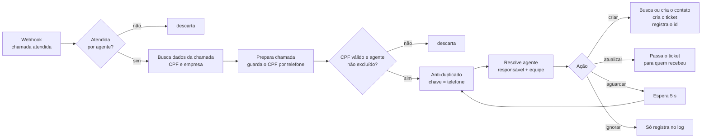

# Protocolo por ligação (n8n)

Workflow n8n que abre **um protocolo no helpdesk para cada ligação atendida**, com o CPF digitado na URA e o agente
certo, **mesmo quando a ligação é transferida**.

> Versão genérica de um fluxo em produção numa operação de atendimento. Não tem dado, id nem credencial do cliente:
> URLs, ids e agentes são de exemplo.

## O problema

A plataforma de telefonia avisa por webhook cada vez que um agente atende. Parece simples: um evento, um ticket.
Na prática:

| Situação | O que dava errado |
|---|---|
| Transferência assistida | Cada perna da ligação gera um evento "atendida", com `correlation_id` próprio: dois protocolos para a mesma ligação |
| 2ª perna da transferência | Não traz o CPF digitado na URA |
| As pernas chegam com ~1 s de diferença | É menos que o tempo de criar o ticket: perguntar "já existe?" não basta, as duas recebem "não" |
| Quem transfere às vezes segura a ligação por alguns segundos | O protocolo tem que ficar com quem **recebeu** |
| Equipe de cobrança | Não gera protocolo. Quando transfere para o atendimento, o protocolo nasce no atendimento |
| Entrada na URA | Também chega como "atendida", com `agent_id` igual a `"None"` |

## Como funciona



O elo entre as pernas de uma ligação é o **telefone de quem ligou**: é a chave do anti-duplicado e é por ele que a
2ª perna recupera o CPF que veio na 1ª.

| Ação | Quando |
|---|---|
| `criar` | 1ª perna da ligação. Reserva a ligação **antes** de criar o ticket, para a perna seguinte já enxergar. |
| `atualizar` | Perna seguinte com o ticket já criado: passa o protocolo para quem recebeu. |
| `aguardar` | Perna seguinte com o ticket ainda sendo criado: espera 5 s e tenta de novo, até 6 vezes. |
| `ignorar` | Perna seguinte de um agente sem mapeamento: não mexe no ticket. |

Se a perna anterior falhar antes de criar o ticket, a reserva expira em 60 s e a perna seguinte cria. Melhor um
protocolo a mais do que uma ligação sem protocolo.

## Armadilhas que o fluxo já trata

- **O helpdesk faz find-or-create em equipe e responsável.** Mandar texto onde vai um id não dá erro: cria uma equipe
  nova com aquele nome. O nó *Resolve Agente* só deixa passar dígitos.
- **PUT com campo vazio apaga o valor atual.** Por isso, agente sem mapeamento na 2ª perna vira `ignorar`, em vez de
  atualizar com vazio.
- **O responsável exige a equipe dele.** Sem os dois, o ticket fica sem dono e cai na fila do serviço, sem erro.
- **A lista de agentes da telefonia é paginada.** Sem paginação, os agentes das últimas páginas somem do mapa (no
  caso real, a equipe de cobrança inteira).
- **O estado só persiste com o workflow ativo.** `$getWorkflowStaticData` não guarda nada em execução manual no editor.

## Resultado em produção

Substituiu uma versão que abria dois protocolos a cada transferência. Hoje é um protocolo por ligação, com o agente
que recebeu a chamada.

## Estrutura

```text
workflows/protocolo-por-ligacao.json   fluxo principal, com notas explicativas no canvas
workflows/gerar-mapa-de-agentes.json   casa os agentes da telefonia com os do helpdesk
exemplos/                              payloads fictícios do webhook e da consulta da chamada
sandbox/n8n.js                         roda os nós Code fora do n8n, com relógio simulado
test/                                  cenários de ponta a ponta e checagens do JSON
```

## Como usar

1. No n8n, use **Import from File** nos dois arquivos de `workflows/`.
2. Crie as credenciais e selecione-as nos nós HTTP: **Header Auth** para a telefonia e **Query Auth** para o helpdesk
   (o helpdesk original recebe a chave por query string).
3. Rode **Gerar mapa de agentes** e cole `mapaAgentes` e `agentesExcluidos` no nó **Config** do fluxo principal,
   junto com as URLs e os ids do helpdesk. Repita quando entrarem agentes novos.
4. Ative o fluxo principal e cadastre a URL de produção do webhook na plataforma de telefonia, no evento de chamada
   atendida.

As rotas (`/calls/{id}/info`, `/contacts`, `/issues`) e o corpo form-urlencoded seguem as APIs originais. Para outro
helpdesk, ajuste os nós HTTP e o *Prepara Chamada*.

## Testes

Requer Node 18 ou mais novo, sem dependências.

```bash
npm test
```

Os testes carregam o **código real dos nós Code** direto do JSON e simulam o resto do n8n: `$json`, `$('Nó')`, o estado
entre execuções e o relógio. Os cenários cobrem ligação direta, transferência assistida com as pernas chegando antes
de o ticket existir, cobrança transferindo para o atendimento, perna que falhou no meio, espera esgotada, agente fora
do mapa e o casamento de agentes por e-mail, login e nome.

Para conferir que os testes pegam o problema original: trocando a chave do anti-duplicado de volta para
`correlation_id`, três cenários falham.

## Licença

MIT
